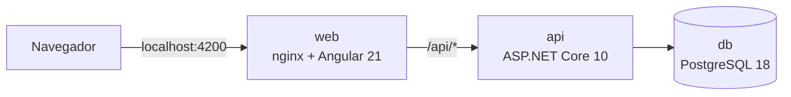

# Cartão de Vacinação

Sistema que gerencia o cartão de vacinação de cada pessoa: cadastro de vacinas e de pessoas, registro de vacinações com validação de cada dose contra o esquema da vacina, consulta do cartão, correção da data de aplicação e exclusão da última dose. O operador entra com e-mail e senha, e a sessão se renova automaticamente por até 7 dias.

O sistema tem uma API REST com JSON e uma interface web em português, responsiva, com temas claro e escuro. O projeto nasceu de um desafio técnico: o [enunciado](PRODUCT.MD) define o problema, e o [PRD](docs/PRD.md) fecha as ambiguidades dele.



| Área | Tecnologia |
|---|---|
| API | ASP.NET Core 10, MediatR 12.5, FluentValidation e EF Core 10 |
| Banco de dados | PostgreSQL 18 |
| Interface | Angular 21 e Angular Material, servidos pelo nginx |
| Testes | xUnit v3, Testcontainers, ArchUnitNET, Vitest e Playwright |

As versões e as licenças estão na [TechSpec §2](docs/TECHSPEC.md#2-stack).

## Como rodar

### Com Docker Compose

É o caminho para avaliar o sistema. Exige só Docker com Compose e as portas 4200, 8080 e 5432 livres.

```bash
git clone https://github.com/yudiyoshida/carteira-vacinacao.git
cd carteira-vacinacao
docker compose up --build
```

O comando fica em primeiro plano, com os logs dos três serviços. A primeira subida baixa as imagens e compila a API e a interface, o que leva alguns minutos. O sistema está pronto quando `http://localhost:8080/health` responde `Healthy`: a API aplica as migrations e carrega os dados de demonstração antes de aceitar requisições.

| Endereço | O que é |
|---|---|
| http://localhost:4200 | interface |
| http://localhost:8080/scalar | documentação interativa da API (Scalar) |
| http://localhost:8080/openapi/v1.json | documento OpenAPI |
| http://localhost:8080/health | verificação de saúde, que inclui o banco de dados |

Para chegar ao cartão da pessoa de demonstração:

1. Abra `http://localhost:4200` e entre com o e-mail `operador@demo.local` e a senha `Demo@2026!`.
2. A lista de pessoas abre em seguida, com `Maria Demonstração`.
3. Na coluna **Ações**, clique no ícone de vacina, de rótulo "Abrir o cartão de Maria Demonstração".

O cartão mostra BCG, DTP e Hepatite B, e o bloco da próxima dose esperada de cada vacina traz o botão **Registrar**.

Os logs da primeira subida trazem mensagens inofensivas. Num volume novo, a API registra um `Error` do EF Core, e o `db`, um `ERROR` sobre `__EFMigrationsHistory`, porque a consulta a essa tabela roda antes de ela existir; as migrations seguem normalmente. Cada container novo da API registra dois `Warning` do Data Protection, e nenhum dado depende dessas chaves.

Para parar:

```bash
docker compose down     # para os serviços e mantém os dados
docker compose down -v  # para os serviços e apaga os dados do volume
```

O `down -v` não tem volta: tudo o que foi cadastrado se perde, e a subida seguinte carrega os dados de demonstração de novo.

Nenhuma configuração é obrigatória, porque os valores de desenvolvimento estão no `docker-compose.yml`. Para sobrescrever algum, copie `.env.example` para `.env`, que fica fora do git ([TechSpec §12.2](docs/TECHSPEC.md#122-configuração)).

O Compose fixa a rede `172.30.240.0/24` e o IP do `web`, para a API aceitar o IP do cliente só do nginx. Se essa faixa colidir com outra rede Docker da máquina, troque a subnet, o IP do `web` e o valor de `ForwardedHeaders__KnownProxies` no `docker-compose.yml`.

### Localmente

É o caminho para desenvolver. Exige .NET SDK 10.0.400 ou superior da série 10.0, Node 22 (22.12 ou superior) e Docker, para o banco de dados. Pare o sistema completo antes, porque as portas são as mesmas. Rode cada bloco num terminal:

```bash
docker compose up db
```

```bash
dotnet run --project backend/src/VaccinationCard.Api
```

```bash
npm --prefix frontend ci
npm --prefix frontend start
```

A interface fica em `http://localhost:4200`, e o `ng serve` repassa `/api` para a API em `http://localhost:8080` (`frontend/proxy.conf.json`). A API lê os valores de desenvolvimento de `appsettings.Development.json`, aplica as migrations e carrega os mesmos dados de demonstração. O banco de dados usa o mesmo volume do sistema completo.

Numa máquina sem configuração do Angular CLI, o primeiro comando dele pergunta sobre autocompletar e sobre o envio de dados de uso, e só continua depois das respostas. As duas podem ser `n`. A resposta sobre dados de uso fica gravada em `frontend/angular.json`, que aparece alterado no git.

### Cookie `Secure` em `http://localhost`

O refresh token vai num cookie `Secure` ([ADR-0007](docs/adr/0007-refresh-token-em-cookie-httponly.md)). O Chrome e o Firefox aceitam esse cookie em `http://localhost`, e o Safari recusa ([bug 232088 do WebKit](https://bugs.webkit.org/show_bug.cgi?id=232088)). O sintoma é entrar normalmente e voltar ao login ao recarregar a página, porque a sessão não se renova. Nesse caso, desligue a flag, só em desenvolvimento:

```bash
RefreshCookie__Secure=false docker compose up --build
```

```bash
RefreshCookie__Secure=false dotnet run --project backend/src/VaccinationCard.Api
```

No Compose, a mesma chave também funciona no `.env`.

## Dados de demonstração

A API carrega estes dados na inicialização, só nas tabelas vazias. `Database__SeedOnStartup=false` desliga a carga.

**Conta de demonstração.** E-mail `operador@demo.local` e senha `Demo@2026!`. É uma credencial pública, só para demonstração.

**Vacinas.** As vacinas abaixo são dados de demonstração, com esquemas simplificados do calendário do PNI, e não substituem o calendário oficial. O banco de dados e a interface não têm marcação própria para elas.

| Vacina | Doses primárias | Doses de reforço |
|---|---|---|
| BCG | 1 | 0 |
| Hepatite B | 3 | 0 |
| DTP | 3 | 2 |
| Poliomielite inativada (VIP) | 3 | 1 |
| Pneumocócica 10-valente | 2 | 1 |
| Meningocócica C | 2 | 1 |
| Tríplice viral | 2 | 0 |
| Febre amarela | 1 | 0 |

**Pessoa de demonstração.** `Maria Demonstração`, CPF fictício `123.456.789-09`, com um cartão parcial: BCG (dose única), Hepatite B (2 de 3 doses primárias) e DTP (série primária completa e 1º reforço).

## API

A base é `/api/v1`, em REST com JSON. A documentação interativa fica no [Scalar](http://localhost:8080/scalar), e [`backend/VaccinationCard.http`](backend/VaccinationCard.http) traz um exemplo por rota. Os contratos estão na [TechSpec §7](docs/TECHSPEC.md#7-api), e os códigos de erro, na [§8.3](docs/TECHSPEC.md#83-códigos).

### Convenções

- **Autenticação:** header `Authorization: Bearer <access token>` em toda rota, exceto login, renovação da sessão (que usa o cookie), `/health`, OpenAPI e Scalar. O access token vale 15 minutos, e o login aceita 5 tentativas por minuto a partir do mesmo IP.
- **Formato:** JSON em camelCase, enums como texto (`Primary`, `Booster`) e datas em `yyyy-MM-dd`.
- **Criação:** `201 { "id": "..." }` e header `Location`.
- **Edição e exclusão:** `200 { "message": "..." }`.
- **Listas:** parâmetros `page`, `size` e `search`, com a busca sem diferenciar maiúsculas e acentos. Pessoas vêm paginadas, com 20 por página por padrão e no máximo 100. Vacinas, sem `page` e `size`, vêm todas numa página só.
- **Erros:** ProblemDetails (RFC 9457), com `code` estável e mensagem em português. Uma falha de validação traz também `errors`, por campo.

### Rotas

| Método | Rota | O que faz | Corpo | Sucesso | Erros |
|---|---|---|---|---|---|
| POST | `/api/v1/auth/login` | abre a sessão (anônima) | `{ email, password }` | `200 { accessToken }` + cookie | 400, 401, 429 |
| POST | `/api/v1/auth/refresh` | renova a sessão (anônima, com o cookie) | — | `200 { accessToken }` + cookie novo | 401 |
| POST | `/api/v1/auth/logout` | encerra a sessão | — | `200 { message }` + cookie apagado | 401 |
| GET | `/api/v1/vaccines` | lista as vacinas | — | `200` lista | 400 |
| GET | `/api/v1/vaccines/{id}` | consulta uma vacina | — | `200` vacina | 404 |
| POST | `/api/v1/vaccines` | cadastra uma vacina | `{ name, primaryDoses, boosterDoses }` | `201 { id }` | 400, 409 |
| GET | `/api/v1/people` | lista as pessoas, com CPF mascarado | — | `200` lista | 400 |
| GET | `/api/v1/people/{id}` | consulta uma pessoa, com CPF formatado | — | `200` pessoa | 404 |
| POST | `/api/v1/people` | cadastra uma pessoa | `{ name, cpf }` | `201 { id }` | 400, 409 |
| DELETE | `/api/v1/people/{id}` | remove a pessoa, o cartão e as vacinações | — | `200 { message }` | 404 |
| GET | `/api/v1/people/{personId}/vaccination-card` | consulta o cartão de vacinação | — | `200` cartão | 404 |
| POST | `/api/v1/people/{personId}/vaccinations` | registra uma vacinação | `{ vaccineId, dose: { type, number }, appliedOn }` | `201 { id }` | 400, 404, 409, 422 |
| GET | `/api/v1/people/{personId}/vaccinations/{vaccinationId}` | consulta uma vacinação | — | `200` vacinação | 404 |
| PATCH | `/api/v1/people/{personId}/vaccinations/{vaccinationId}` | corrige a data de aplicação | `{ appliedOn }` | `200 { message }` | 400, 404, 409, 422 |
| DELETE | `/api/v1/people/{personId}/vaccinations/{vaccinationId}` | exclui a última dose | — | `200 { message }` | 404, 409, 422 |
| GET | `/health` | verifica a saúde do sistema (anônima) | — | `200` | 503 |

As rotas protegidas também podem responder `401`. Com access token, uma rota inexistente responde `404`, e um método não aceito, `405`; uma rota com corpo pode responder `415`.

### Exemplos com `curl`

Os exemplos usam `bash`, `curl` e `jq`, com o sistema no ar. Rode na ordem e no mesmo terminal, porque cada bloco usa as variáveis do anterior. O último passo remove a pessoa criada, então a sequência roda de novo e não altera o cartão da pessoa de demonstração.

**Sessão.** O login guarda o cookie do refresh token num arquivo temporário, e a renovação troca o par de tokens.

```bash
API=http://localhost:8080
COOKIES=$(mktemp)

TOKEN=$(curl -s -c "$COOKIES" "$API/api/v1/auth/login" \
  -H 'Content-Type: application/json' \
  -d '{"email":"operador@demo.local","password":"Demo@2026!"}' | jq -r .accessToken)

TOKEN=$(curl -s -X POST -b "$COOKIES" -c "$COOKIES" "$API/api/v1/auth/refresh" | jq -r .accessToken)

AUTH="Authorization: Bearer $TOKEN"
```

**Vacinas.** Uma vacina não pode ser editada nem removida, e repetir o nome responde `409`.

```bash
# Listar todas, buscar sem acento e consultar uma
curl -s "$API/api/v1/vaccines" -H "$AUTH" | jq .
curl -s "$API/api/v1/vaccines?search=triplice" -H "$AUTH" | jq .

VACCINE_ID=$(curl -s "$API/api/v1/vaccines?search=hepatite%20b" -H "$AUTH" | jq -r '.data[0].id')
curl -s "$API/api/v1/vaccines/$VACCINE_ID" -H "$AUTH" | jq .

# Cadastrar
curl -s "$API/api/v1/vaccines" -H "$AUTH" -H 'Content-Type: application/json' \
  -d '{"name":"Hepatite A","primaryDoses":2,"boosterDoses":0}' | jq .
```

As listas respondem com este envelope, como na busca por `triplice`:

```json
{
  "currentPage": 1,
  "itemsPerPage": 1,
  "totalItems": 1,
  "totalPages": 1,
  "data": [
    { "id": "01a19869-...", "name": "Tríplice viral", "primaryDoses": 2, "boosterDoses": 0 }
  ]
}
```

**Pessoas.** O CPF vai só no corpo, com ou sem máscara, e nunca na URL.

```bash
# Cadastrar
PERSON_ID=$(curl -s "$API/api/v1/people" -H "$AUTH" -H 'Content-Type: application/json' \
  -d '{"name":"João da Silva","cpf":"111.444.777-35"}' | jq -r .id)

# Listar, com CPF mascarado
curl -s "$API/api/v1/people?search=joao&page=1&size=20" -H "$AUTH" | jq .

# Consultar, com CPF formatado
curl -s "$API/api/v1/people/$PERSON_ID" -H "$AUTH" | jq .
```

**Vacinações e cartão.** Cada registro aceita só a próxima dose esperada da vacina.

```bash
VACCINATIONS="$API/api/v1/people/$PERSON_ID/vaccinations"

# Registrar a 1ª dose
VACCINATION_ID=$(curl -s "$VACCINATIONS" -H "$AUTH" -H 'Content-Type: application/json' \
  -d "{\"vaccineId\":\"$VACCINE_ID\",\"dose\":{\"type\":\"Primary\",\"number\":1},\"appliedOn\":\"2026-01-15\"}" | jq -r .id)

# Consultar a vacinação e o cartão
curl -s "$VACCINATIONS/$VACCINATION_ID" -H "$AUTH" | jq .
curl -s "$API/api/v1/people/$PERSON_ID/vaccination-card" -H "$AUTH" | jq .

# Corrigir a data de aplicação
curl -s -X PATCH "$VACCINATIONS/$VACCINATION_ID" -H "$AUTH" -H 'Content-Type: application/json' \
  -d '{"appliedOn":"2026-01-20"}' | jq .

# Tentar pular a 2ª dose: recusa com 422
curl -s "$VACCINATIONS" -H "$AUTH" -H 'Content-Type: application/json' \
  -d "{\"vaccineId\":\"$VACCINE_ID\",\"dose\":{\"type\":\"Primary\",\"number\":3},\"appliedOn\":\"2026-03-15\"}" | jq .

# Excluir a última dose
curl -s -X DELETE "$VACCINATIONS/$VACCINATION_ID" -H "$AUTH" | jq .
```

O cartão traz, por vacina, o esquema, as doses aplicadas, o progresso e a próxima dose esperada:

```json
{
  "person": { "id": "01a1986b-...", "name": "João da Silva", "cpf": "111.444.777-35" },
  "vaccines": [
    {
      "vaccineId": "01a19869-...",
      "vaccineName": "Hepatite B",
      "scheme": { "primaryDoses": 3, "boosterDoses": 0 },
      "doses": [
        { "vaccinationId": "01a1986b-...", "dose": { "type": "Primary", "number": 1 }, "appliedOn": "2026-01-15" }
      ],
      "progress": { "primaryApplied": 1, "primaryTotal": 3, "primarySeriesComplete": false, "boostersApplied": 0, "boostersTotal": 0 },
      "nextExpectedDose": { "type": "Primary", "number": 2 }
    }
  ]
}
```

A recusa vem em ProblemDetails, com o `code` da regra:

```json
{
  "title": "Regra de negócio violada",
  "status": 422,
  "detail": "A dose informada não é a próxima dose esperada desta vacina.",
  "instance": "/api/v1/people/01a1986b-.../vaccinations",
  "code": "vaccination.dose_out_of_sequence",
  "traceId": "00-ff001f90..."
}
```

**Encerramento.** A remoção da pessoa é definitiva, e o logout invalida o refresh token.

```bash
curl -s -X DELETE "$API/api/v1/people/$PERSON_ID" -H "$AUTH" | jq .

curl -s -X POST -b "$COOKIES" -c "$COOKIES" "$API/api/v1/auth/logout" -H "$AUTH" | jq .
rm "$COOKIES"
```

## Testes

| Comando | O que faz |
|---|---|
| `dotnet build backend/VaccinationCard.slnx` | compila o backend, com warnings tratados como erros |
| `dotnet test backend/VaccinationCard.slnx` | roda os testes de unidade, de integração e de arquitetura; os de integração sobem um PostgreSQL pelo Testcontainers e exigem Docker |
| `dotnet test backend/VaccinationCard.slnx --filter "RN=RN10"` | roda só os testes de uma regra |
| `npm --prefix frontend ci` | instala as dependências do frontend |
| `npm --prefix frontend test` | roda os testes do frontend, com Vitest |
| `npm --prefix frontend test -- --filter RN18` | roda só os testes do frontend de uma regra |
| `npm --prefix frontend run lint` | roda o ESLint |
| `npm --prefix frontend run build` | compila o frontend |

No backend, cada teste de regra leva `[Trait("RN", "RNxx")]`; no frontend, o código da regra fica no nome do teste. A RN18, de rótulos de dose, é regra da interface e só tem testes no frontend.

O E2E smoke, com Playwright, percorre a interface com o sistema no ar pelo Docker Compose:

```bash
npm --prefix frontend ci
(cd frontend && npx playwright install chromium)
npm --prefix frontend run e2e
```

O teste entra com a conta de demonstração, registra a próxima dose da pessoa de demonstração e a exclui no fim, o que devolve o cartão ao estado inicial. Uma execução interrompida antes da exclusão deixa a dose no cartão, e a seguinte falha até alguém usar "Excluir dose" na interface ou rodar `docker compose down -v`, que apaga também os demais dados do volume.

O [CI](.github/workflows/ci.yml) roda a cada push e pull request: build e testes do backend; lint, build e testes do frontend. O E2E smoke fica fora dele, porque depende do Compose no ar. O [roteiro de testes manuais](docs/MANUAL-API-TESTS.md) confere a API passo a passo no Scalar.

## Arquitetura e decisões

O backend é um único projeto ASP.NET Core, dividido em quatro módulos: `People` (pessoas, vacinações e cartão), `Vaccines`, `Accounts` e `Authentication`. O DDD e a Clean Architecture pedidos no enunciado aparecem em cada módulo, com as camadas `Domain`, `Application` e `Infra` e as dependências apontando para o domínio. Cada caso de uso é um command ou uma query do MediatR; a leitura passa por DAO, e a escrita do agregado, por Repository. Como o compilador não separa camadas dentro de um projeto, os testes de arquitetura garantem a direção das dependências, com as regras A1–A7 da [TechSpec §4](docs/TECHSPEC.md#4-arquitetura-do-backend).

O frontend usa Angular 21 com standalone components, signals e zoneless, dividido em `core`, `modules` e `shared` ([TechSpec §11](docs/TECHSPEC.md#11-frontend)). O nginx serve a interface e repassa `/api` para a API, na mesma origem e sem CORS.

O enunciado deixa pontos em aberto, e o PRD fecha cada um. Os principais:

- A dose "deve ser validada", mas a vacina só tinha nome e identificador. A vacina ganhou um esquema de doses, e o registro aceita só a próxima dose esperada.
- A "atualização" citada na descrição virou a correção da data de aplicação. Editar pessoa ou vacina fica fora do escopo.
- O "número de identificação único" da pessoa é o CPF, com uma chave interna separada, para o CPF nunca aparecer em URL.
- A autenticação, citada como bônus, entrou com refresh token.

As decisões de arquitetura estão nos ADRs:

| ADR | Decisão |
|---|---|
| [0001](docs/adr/0001-projeto-unico-com-modulos.md) | Projeto único com módulos, em vez de um projeto por camada, com as dependências garantidas por testes de arquitetura |
| [0002](docs/adr/0002-ddd-light-so-onde-ha-regra.md) | DDD-light só onde há regra: `People` tem modelo rico; `Vaccines` e `Accounts` são CRUD simples |
| [0003](docs/adr/0003-dao-para-leitura-e-repository-para-escrita.md) | Leitura por DAO, com projeção em DTO, e escrita por Repository, pelo agregado inteiro |
| [0004](docs/adr/0004-modelos-de-persistencia-separados.md) | Modelos de persistência separados das entidades: Domain e Application não referenciam o EF Core |
| [0005](docs/adr/0005-mediatr-12-5.md) | MediatR fixado na 12.5.0, a última versão Apache-2.0 |
| [0006](docs/adr/0006-erros-por-categoria-em-problemdetails.md) | Quatro exceções por categoria, convertidas em ProblemDetails com `code` estável |
| [0007](docs/adr/0007-refresh-token-em-cookie-httponly.md) | Refresh token em cookie `HttpOnly`, com rotação e uma sessão por conta; access token só em memória |
| [0008](docs/adr/0008-esquema-de-doses-e-sequencia-estrita.md) | Esquema de doses na vacina e sequência estrita: só a próxima dose esperada, em ordem cronológica, e exclusão só da última dose |
| [0009](docs/adr/0009-remocao-definitiva-de-pessoa.md) | Remoção definitiva da pessoa, em cascata e sem soft delete, porque vacinação é dado pessoal sensível na LGPD |
| [0010](docs/adr/0010-postgresql.md) | PostgreSQL 18 no Compose e nos testes de integração |
| [0011](docs/adr/0011-comunicacao-entre-modulos-por-queries.md) | Comunicação entre módulos só por queries do MediatR |
| [0012](docs/adr/0012-vacinacoes-no-agregado-da-pessoa.md) | Vacinações no agregado da pessoa, sem módulo próprio |

## Limitações conhecidas

- Os esquemas de doses são simplificados e não substituem o calendário oficial.
- Não há vacinas recorrentes (ex: influenza anual), intervalo mínimo entre doses nem registro histórico com lacuna (ex: só a 2ª dose comprovada).
- Ficam fora do escopo editar pessoa, editar ou remover vacina, buscar pessoa por CPF, cadastrar contas, recuperar senha e perfis de acesso.
- Cada conta tem uma sessão ativa por vez: um novo login encerra a sessão anterior.
- Duas renovações simultâneas com o mesmo cookie, como duas abas abrindo juntas, podem exigir um novo login. Uma renovação em andamento durante o logout pode reabrir a sessão. Os dois casos são raros e de consequência branda.
- O limite de tentativas de login fica em memória, por instância da API. O fim da janela de 1 minuto não tem teste automatizado.
- O Compose usa HTTP e segredos de desenvolvimento: é um ambiente de demonstração, não de produção.
- Ícones e fonte vêm do Google Fonts: sem internet, os ícones aparecem como texto.
- A busca por nome com `unaccent` não usa índice, o que é aceitável com o volume de dados pequeno.
- O MediatR fica na 12.5, que não recebe novas versões. Qualquer atualização exige rever a licença.

## Uso de IA

O projeto foi feito com o [Claude Code](https://claude.com/claude-code), num fluxo guiado por especificação.

- **Especificação antes do código:** uma sessão de perguntas e respostas fechou as ambiguidades do enunciado. Dela saíram o [PRD](docs/PRD.md) e o [glossário](GLOSSARY.md); depois vieram a [TechSpec](docs/TECHSPEC.md), os [ADRs](docs/adr/) e o [plano de tasks](docs/TASKS.md).
- **Contexto do agente:** [`.agents/`](.agents/) guarda o contexto do projeto, as regras de arquitetura e uma skill por tipo de mudança, versionados com o código.
- **Decisões do autor:** a IA levantou fatos e recomendou uma opção em cada ponto da definição, e o autor decidiu. Em alguns pontos, a decisão foi diferente da recomendação: Controllers em vez de Minimal APIs, projeto único com módulos em vez de um projeto por camada, exceções por categoria em vez de uma exceção por razão, refresh token em vez de um token de 60 minutos e Angular 21 LTS em vez de Angular 22. Outras recomendações foram aceitas com ajuste, como proibir o EF Core na Application.
- **Execução:** a IA executa uma task do plano por vez, com TDD nas regras de domínio, e para no fim com os arquivos alterados, os comandos executados e o resultado de cada um, as regras cobertas e as pendências.
- **Revisão de cada task:** o autor revisa cada entrega e faz o commit. No git, a IA só lê.

## Documentação

| Documento | Conteúdo |
|---|---|
| [`PRODUCT.MD`](PRODUCT.MD) | enunciado do desafio |
| [`docs/PRD.md`](docs/PRD.md) | funcionalidades, regras de negócio (RN01–RN26) e critérios de aceite |
| [`GLOSSARY.md`](GLOSSARY.md) | termos do domínio e o nome de cada um no código |
| [`docs/TECHSPEC.md`](docs/TECHSPEC.md) | como o sistema é construído |
| [`docs/adr/`](docs/adr/) | o porquê das decisões de arquitetura |
| [`docs/TASKS.md`](docs/TASKS.md) | plano, ordem e progresso das tasks |
| [`docs/MANUAL-API-TESTS.md`](docs/MANUAL-API-TESTS.md) | roteiro de testes manuais da API |
| [`backend/VaccinationCard.http`](backend/VaccinationCard.http) | um exemplo de chamada por rota |
| [`.agents/`](.agents/) | contexto, regras e skills do agente |
