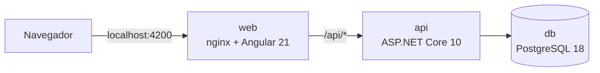

# TechSpec — Cartão de Vacinação

| | |
|---|---|
| Versão | 1.0 |
| Data | 28/10/2026 |
| Status | Em revisão |
| Base | [PRD](PRD.md), [glossário](../GLOSSARY.md) e [ADRs](adr/) |

Este documento descreve como o sistema é construído. As funcionalidades (F01–F10) e as regras de negócio (RN01–RN26) estão no PRD e aparecem aqui só por referência.

## 1. Visão geral



- O nginx serve o frontend e repassa `/api` para a API. Interface e API ficam na mesma origem, sem CORS.
- A API é um único projeto ASP.NET Core, dividido em módulos de feature. Cada módulo tem `Domain`, `Application` e `Infra` ([ADR-0001](adr/0001-projeto-unico-com-modulos.md)).
- Cada caso de uso é um command ou uma query do MediatR. A leitura passa por DAO; a escrita do agregado passa por Repository ([ADR-0003](adr/0003-dao-para-leitura-e-repository-para-escrita.md)).
- `docker compose up --build` sobe o sistema inteiro.

## 2. Stack

| Área | Tecnologia | Versão | Licença |
|---|---|---|---|
| Runtime e web | .NET e ASP.NET Core, com Controllers | 10.0 (SDK 10.0.400) | MIT |
| Mediator | MediatR ([ADR-0005](adr/0005-mediatr-12-5.md)) | 12.5.0 | Apache-2.0 |
| Validação | FluentValidation + FluentValidation.DependencyInjectionExtensions | 12.2.0 | Apache-2.0 |
| ORM | EF Core + Npgsql.EntityFrameworkCore.PostgreSQL; Microsoft.EntityFrameworkCore.Design para o `dotnet-ef` | 10.0.x | MIT / PostgreSQL |
| Nomes no banco de dados | EFCore.NamingConventions (snake_case) | 10.0.1 | Apache-2.0 |
| Banco de dados | PostgreSQL ([ADR-0010](adr/0010-postgresql.md)) | 18 | PostgreSQL |
| Autenticação | Microsoft.AspNetCore.Authentication.JwtBearer + `PasswordHasher<T>` de Microsoft.Extensions.Identity.Core, que já vem no shared framework do ASP.NET Core, sem `PackageReference` (NU1510) | 10.0.x | MIT |
| OpenAPI | Microsoft.AspNetCore.OpenApi + Scalar.AspNetCore | 10.0.x / 2.18.x | MIT |
| Health check | Microsoft.Extensions.Diagnostics.HealthChecks.EntityFrameworkCore | 10.0.x | MIT |
| Testes do backend | xUnit v3 (pacote `xunit.v3.mtp-off`), NSubstitute, Shouldly, Testcontainers.PostgreSql, Respawn, TngTech.ArchUnitNET.xUnitV3, Microsoft.AspNetCore.Mvc.Testing, Microsoft.Extensions.TimeProvider.Testing, Microsoft.Extensions.Diagnostics.Testing | 4.0 / 6.2 / 4.3 / 4.16 / 7.0 / 0.13 / 10.0 / 10.x / 10.x | Apache-2.0, BSD-3, BSD-3, MIT, Apache-2.0, Apache-2.0, MIT, MIT, MIT |
| Runner dos testes do backend | xunit.runner.visualstudio + Microsoft.NET.Test.Sdk (modo VSTest do `dotnet test`) | 4.0 / 18.x | Apache-2.0, MIT |
| Frontend | Angular 21 LTS, Angular Material 21, @angular/material-date-fns-adapter + date-fns | 21.2.x / 4.x | MIT |
| Testes do frontend | Vitest com jsdom, via `@angular/build:unit-test` | 4.x | MIT |
| Qualidade do frontend | ESLint, angular-eslint e typescript-eslint; Prettier | 10.x / 21.x / 8.x; 3.x | MIT |
| Ícones e fonte | Material Symbols Outlined e Roboto, pelo Google Fonts | — | Apache-2.0, OFL-1.1 |
| Node | Node.js | 22 (≥ 22.12) | MIT |
| Servidor web | nginx | stable-alpine | BSD-2 |

As versões dos pacotes .NET ficam centralizadas em `backend/Directory.Packages.props`. FluentAssertions fica fora, porque a v8 tem licença comercial.

O xUnit v3 4.0 liga o Microsoft Testing Platform v2 por padrão, e o `dotnet test` do SDK 10 recusa esse modo no runner VSTest. Os projetos de teste usam `xunit.v3.mtp-off` com o runner VSTest, que mantém o filtro `--filter "RN=RNxx"`.

## 3. Estrutura do repositório

```
.
├── backend/
│   ├── VaccinationCard.slnx
│   ├── Directory.Build.props        # net10.0, nullable, warnings como erro
│   ├── Directory.Packages.props     # versões centralizadas
│   ├── global.json                  # fixa o SDK 10
│   ├── .editorconfig
│   ├── Dockerfile
│   ├── VaccinationCard.http         # exemplos de chamadas
│   ├── src/VaccinationCard.Api/
│   └── tests/
│       ├── VaccinationCard.UnitTests/
│       ├── VaccinationCard.IntegrationTests/
│       └── VaccinationCard.ArchitectureTests/
├── frontend/                        # Angular 21, Dockerfile e nginx.conf
├── docs/
│   ├── PRD.md
│   ├── TECHSPEC.md
│   ├── TASKS.md
│   └── adr/
├── .agents/                         # contexto, regras e skills do agente
├── .claude/skills/<skill> -> ../../.agents/skills/<skill>   # um symlink por skill
├── CLAUDE.md -> .agents/context.md
├── AGENTS.md -> .agents/context.md
├── .github/workflows/ci.yml
├── .config/dotnet-tools.json        # dotnet-ef, usado nas migrations
├── .mcp.json                        # servidor MCP do Angular CLI
├── docker-compose.yml
├── .env.example
├── GLOSSARY.md
└── README.md
```

## 4. Arquitetura do backend

### 4.1 Pastas do projeto

```
src/VaccinationCard.Api/
├── Program.cs              # composição: Core, Infra e módulos
├── Core/                   # base da aplicação, sem ASP.NET Core nem EF Core
│   ├── Behaviors/          # ValidationBehavior do MediatR
│   ├── CoreExtensions.cs   # AddCore(): MediatR, ValidationBehavior, validators e relógio
│   ├── Messages/           # SuccessMessage
│   ├── Time/               # IClock e Clock: "hoje" no fuso configurado
│   └── Validation/         # regras reutilizadas (paginação, busca)
├── Infra/                  # adaptadores técnicos globais
│   ├── Database/           # AppDbContext, Migrations e Seeds
│   ├── Http/               # formato dos erros, exception handler, rate limit, forwarded headers, headers de segurança, log de requisição
│   └── OpenApi/
├── Shared/                 # blocos reutilizáveis, sem dependência de framework
│   ├── Errors/             # NotFoundException, ConflictException, BusinessRuleException, UnauthorizedException
│   ├── Pagination/         # envelope Paginated<T>
│   └── ValueObjects/       # Cpf
└── Modules/
    ├── People/
    ├── Vaccines/
    ├── Accounts/
    └── Authentication/
```

Todo módulo segue o mesmo formato. Exemplo de `People`:

```
Modules/People/
├── PeopleModule.cs                   # AddPeopleModule(): registra ports e adapters
├── Domain/
│   ├── Entities/                     # Person, Vaccination
│   ├── Factories/                    # PersonFactory (Create, Load)
│   └── Errors/                       # PeopleErrors: códigos e mensagens
├── Application/
│   ├── Dtos/                         # PersonDto, PersonSummaryDto, VaccinationDto, VaccinationCardDto
│   ├── Persistence/
│   │   ├── Dao/IPersonDao.cs
│   │   └── Repository/IPersonRepository.cs
│   └── UseCases/
│       └── RegisterVaccination/
│           ├── RegisterVaccinationCommand.cs
│           ├── RegisterVaccinationHandler.cs
│           ├── RegisterVaccinationValidator.cs
│           └── RegisterVaccinationOutput.cs
└── Infra/
    ├── Drivers/Http/                 # PeopleController, VaccinationsController
    └── Driven/Persistence/EfCore/    # PersonRecord, VaccinationRecord, configurações, PersonDao, PersonRepository
```

`Drivers` são as entradas do módulo (HTTP); `Driven` são as saídas (persistência, segurança). Os ports de saída ficam na Application, e as implementações, na Infra do próprio módulo: os de persistência em `Application/Persistence/{Dao,Repository}` e `Infra/Driven/Persistence/EfCore`; os de segurança em `Application/Security` e `Infra/Driven/Security`. Um serviço da Application usado por mais de um caso de uso fica em `Application/Services`.

### 4.2 Regras de dependência

O compilador não separa camadas dentro de um projeto. Os testes de `VaccinationCard.ArchitectureTests` (ArchUnitNET, por namespace) garantem estas regras:

| # | Regra |
|---|---|
| A1 | `Modules.*.Domain` depende só de `Shared` e da BCL. Não usa MediatR, FluentValidation, EF Core nem ASP.NET Core. |
| A2 | `Modules.*.Application` não depende de nenhuma `Infra` (do módulo ou global), de EF Core, de Npgsql nem de ASP.NET Core. |
| A3 | Um módulo não depende da `Infra` nem de `Application.Persistence` de outro módulo. |
| A4 | Entre módulos, a Application usa só queries (`*Query`) e DTOs do outro módulo. Exceção: o Domain e a Application de `People` usam também os value objects e enums de `Vaccines.Domain`. |
| A5 | Controllers (`Infra.Drivers.Http`) não dependem de `Application.Persistence` nem de EF Core. |
| A6 | `Shared` não depende de `Core`, `Infra` nem `Modules`. `Core` não depende de `Infra`, `Modules`, EF Core nem ASP.NET Core. |
| A7 | Sufixos obrigatórios: `*Command`, `*Query`, `*Handler`, `*Validator`, `*Output`, `*Dto`, `*Dao`, `*Repository`, `*Controller`, `*Record` e `*Configuration`. |

### 4.3 Comunicação entre módulos

Um módulo usa outro só por queries do MediatR (`ISender.Send`), nunca por DAO, Repository ou tabela do outro módulo. Commands não cruzam módulos ([ADR-0011](adr/0011-comunicacao-entre-modulos-por-queries.md)).

| Consumidor | Query | Fornecedor | Uso |
|---|---|---|---|
| People | `FindVaccineByIdQuery` | Vaccines | esquema da vacina ao registrar uma vacinação |
| People | `FindVaccinesByIdsQuery` | Vaccines | nome e esquema das vacinas do cartão |
| Authentication | `VerifyAccountCredentialsQuery` | Accounts | conferir e-mail e senha no login |
| Authentication | `FindAccountByIdQuery` | Accounts | conferir se a conta existe ao renovar a sessão |

A chave estrangeira de `vaccinations.vaccine_id` para `vaccines.id` existe no banco de dados para garantir a integridade referencial, mas o código de `People` não lê a tabela `vaccines`. A chave é declarada no `AppDbContext`, a única peça que conhece os registros dos dois módulos: a configuração de `VaccinationRecord`, em People, não referencia `VaccineRecord` (A3).

### 4.4 Fluxo de uma requisição

1. O MVC lê o corpo e os parâmetros. Um JSON malformado ou um valor de tipo errado responde `400` (§8.1). O MVC não exige os campos não anuláveis (`SuppressImplicitRequiredAttributeForNonNullableReferenceTypes`), então as mensagens de campo vêm só dos validators.
2. O controller monta o command ou a query e chama `ISender.Send`.
3. O `ValidationBehavior` executa os validators do FluentValidation. Se algum falha, a resposta é `400`.
4. O handler orquestra: lê dados pelos ports, chama o domínio e grava pelo Repository (ou pelo DAO, num módulo simples).
5. O handler devolve um `*Output`, um DTO ou um `SuccessMessage`, nunca uma entidade.
6. O controller responde `201 { id }` + `Location` na criação e `200` nos demais casos.
7. Uma exceção de categoria (§8) chega ao `IExceptionHandler`, que responde em ProblemDetails.

### 4.5 Convenções de código

- C# com `Nullable` e `ImplicitUsings` ativos, warnings tratados como erro, namespace por arquivo e um tipo público por arquivo. O build recusa namespace com bloco (IDE0161) ou diferente da pasta (IDE0130), porque as regras de arquitetura se apoiam no namespace (`EnforceCodeStyleInBuild` e `backend/.editorconfig`).
- Classes `sealed` por padrão. Commands, queries, DTOs e outputs são `record`.
- Injeção de dependência por construtor primário. Métodos assíncronos levam o sufixo `Async`, exceto o `Handle` do MediatR e as actions dos controllers: o ASP.NET Core tira o sufixo do nome da action, e o `CreatedAtAction` deixaria de achar a rota.
- Métodos com corpo em bloco, mesmo com um só `return`. O corpo de expressão (`=>`) só aparece em propriedades e em extensões e helpers privados de uma expressão; nos testes, também em construtores e membros de uma expressão.
- Comentários em inglês, só para o que o código não diz sozinho: a razão de uma escolha ou a regra que o trecho cumpre. Quando a fonte é um documento, o comentário cita a RN, a seção desta TechSpec ou o ADR.
- Um caso de uso por pasta, em `Application/UseCases/<Verbo><Entidade>/`. Verbos padrão: `Create`, `FindAll`, `FindById`, `Delete`; verbos do domínio quando existem (`Register`, `Correct`, `SignIn`, `RefreshSession`, `SignOut`).
- Cada módulo registra as próprias dependências em `<Módulo>Module.cs` (`Add<Módulo>Module`), chamado pelo `Program.cs`. O MediatR, o `ValidationBehavior` e os validators são registrados uma vez, no `AddCore` (`Core/CoreExtensions.cs`), que varre o assembly da API; um caso de uso novo não precisa de registro. O `AddCore` registra também o `TimeProvider` e o `IClock`, que lê o fuso de `App:TimeZone`.
- Mensagens para o operador em português; identificadores em inglês.
- O handler aplica `Trim` nos nomes antes de chamar o domínio. Senhas nunca são alteradas.
- Ids gerados com `Guid.CreateVersion7()`.

## 5. Módulos

### 5.1 Vaccines (CRUD simples)

O módulo não tem entidade ([ADR-0002](adr/0002-ddd-light-so-onde-ha-regra.md)). Os conceitos de dose ficam no domínio dele, porque uma dose é uma posição no esquema de uma vacina.

- **Domain:**
  - `ValueObjects/DoseScheme`: doses primárias (1–10) e doses de reforço (0–5); `Contains(dose)`, `OrderedDoses()` e `NextExpectedDose(registeredDoses)`.
  - `ValueObjects/Dose`: tipo + número (≥ 1); ordem da sequência: primárias antes dos reforços, depois número crescente.
  - `Enums/DoseType`: `Primary` (1) e `Booster` (2). O enum não tem o valor 0: um tipo ausente no corpo chega como 0, e o validator recusa (RN08).
  - `Errors/VaccinesErrors`.
- **Application:**
  - `Dtos/VaccineDto(Id, Name, PrimaryDoses, BoosterDoses)` e `Dtos/DoseDto(Type, Number)`. O `DoseDto` também entra nos contratos de People.
  - `IVaccineDao`: `FindAllAsync`, `FindByIdAsync`, `FindByIdsAsync`, `ExistsByNameAsync` e `SaveAsync`. Num módulo simples, o DAO também grava.

  | Caso de uso | Tipo | Saída |
  |---|---|---|
  | `CreateVaccine` | Command (`Name`, `PrimaryDoses`, `BoosterDoses`) | `CreateVaccineOutput(Id)` |
  | `FindAllVaccines` | Query (`Page`, `Size`, `Search`) | `Paginated<VaccineDto>` |
  | `FindVaccineById` | Query (`Id`) | `VaccineDto` |
  | `FindVaccinesByIds` | Query (`Ids`) | lista de `VaccineDto`, em ordem de nome; um id sem vacina fica de fora |

- **Infra:** `VaccinesController` (`/api/v1/vaccines`); `VaccineRecord`, configuração e `VaccineDao`.

### 5.2 People (DDD-light)

**Agregado:**

```
Person (raiz)
├── Id: Guid
├── Name: string
├── Cpf: Cpf
└── Vaccinations: IReadOnlyList<Vaccination>
    ├── Id: Guid
    ├── VaccineId: Guid
    ├── Dose: Dose
    └── AppliedOn: DateOnly
```

- As vacinações ficam dentro do agregado, e não num módulo próprio, porque as regras de dose dependem do cartão inteiro da pessoa ([ADR-0012](adr/0012-vacinacoes-no-agregado-da-pessoa.md)).
- Os construtores são `internal`. `PersonFactory.Create(name, cpf)` cria uma pessoa nova; `PersonFactory.Load(...)` reconstrói uma pessoa lida do banco de dados, sem revalidar as regras. Só o Repository usa o `Load`.
- Métodos do agregado:
  - `RegisterVaccination(Guid vaccineId, DoseScheme scheme, Dose dose, DateOnly appliedOn, DateOnly today): Vaccination`
  - `CorrectVaccinationDate(Guid vaccinationId, DateOnly appliedOn, DateOnly today)`
  - `RemoveVaccination(Guid vaccinationId)`
  - `NextExpectedDose(Guid vaccineId, DoseScheme scheme): Dose?`

**Registro de vacinação** ([ADR-0008](adr/0008-esquema-de-doses-e-sequencia-estrita.md)). Os passos seguem a ordem do PRD, que define qual erro aparece quando mais de uma regra é violada:

1. `scheme.Contains(dose)` é falso: `BusinessRuleException` `vaccination.dose_outside_scheme` (RN09).
2. A dose já tem vacinação registrada: `ConflictException` `vaccination.dose_already_registered` (RN11).
3. A dose não é a próxima dose esperada: `BusinessRuleException` `vaccination.dose_out_of_sequence` (RN10).
4. `appliedOn` depois de `today`: `vaccination.applied_on_in_future`; antes de 01/01/1900: `vaccination.applied_on_before_minimum` (RN12).
5. `appliedOn` igual ou anterior à data da dose anterior: `vaccination.applied_on_not_after_previous` (RN13).
6. O agregado inclui a `Vaccination`, com id novo.

As vacinações registradas de uma vacina são sempre um prefixo de `scheme.OrderedDoses()`, por causa da regra de sequência. Por isso, a próxima dose esperada é `OrderedDoses()[n]`, onde `n` é a quantidade de vacinações da vacina. Quando `n` alcança o total do esquema, não há próxima dose. `DoseScheme.NextExpectedDose(n)` guarda essa regra, e o agregado e o cartão de vacinação usam o mesmo método.

**Correção de data (RN14).** O agregado localiza a vacinação (`vaccination.not_found`), aplica RN12 e exige `data anterior < nova data < data seguinte`, considerando só as doses vizinhas que existem (`vaccination.applied_on_out_of_order`).

**Exclusão (RN15).** O agregado localiza a vacinação e só a remove se ela for a última da sequência da vacina (`vaccination.not_last_dose`).

**Application:**

| Caso de uso | Tipo | Saída |
|---|---|---|
| `CreatePerson` | Command (`Name`, `Cpf`) | `CreatePersonOutput(Id)` |
| `FindAllPeople` | Query (`Page`, `Size`, `Search`) | `Paginated<PersonSummaryDto>`, com CPF mascarado |
| `FindPersonById` | Query (`Id`) | `PersonDto`, com CPF formatado |
| `DeletePerson` | Command (`Id`) | `SuccessMessage` |
| `RegisterVaccination` | Command (`PersonId`, `VaccineId`, `Dose`, `AppliedOn`) | `RegisterVaccinationOutput(Id)` |
| `FindVaccinationById` | Query (`PersonId`, `VaccinationId`) | `VaccinationDto` |
| `CorrectVaccinationDate` | Command (`PersonId`, `VaccinationId`, `AppliedOn`) | `SuccessMessage` |
| `DeleteVaccination` | Command (`PersonId`, `VaccinationId`) | `SuccessMessage` |
| `FindVaccinationCard` | Query (`PersonId`) | `VaccinationCardDto` |

- `IPersonDao`: `FindAllAsync`, `FindByIdAsync`, `FindVaccinationAsync`, `FindCardDataAsync` (pessoa + vacinações numa consulta só, sem dados das vacinas; `null` quando a pessoa não existe) e `ExistsByCpfAsync`.
- `IPersonRepository`: `SaveAsync(person)`, `EditAsync(person)`, `DeleteAsync(id)` e `FindByIdAsync(id)`. O `DeleteAsync` remove a pessoa com um único `DELETE` e devolve se ela existia; quando não existia, o `DeletePersonHandler` lança `person.not_found`.
- `RegisterVaccinationHandler`: carrega a pessoa pelo Repository, busca a vacina com `FindVaccineByIdQuery`, monta o `DoseScheme`, chama o agregado com `IClock.Today` e grava com `EditAsync`.
- `FindVaccinationByIdHandler`: lê a vacinação da pessoa pelo `FindVaccinationAsync`. Quando não a encontra, confere a pessoa pelo `FindByIdAsync`: uma pessoa inexistente responde `person.not_found`, como na correção e na exclusão, que carregam o agregado; senão, a resposta é `vaccination.not_found`.
- `FindVaccinationCardHandler`: lê a pessoa e as vacinações pelo DAO (uma pessoa inexistente responde `person.not_found`), busca as vacinas com `FindVaccinesByIdsQuery` e monta o cartão (RN17):
  - as vacinas seguem a ordem da query, que já vem por nome, na collation do banco de dados (§6.2);
  - as doses seguem a ordem da sequência, pela comparação de `Dose`. O banco de dados não serve para essa ordem, porque `dose_type` é texto e `Booster` vem antes de `Primary`;
  - o progresso e a próxima dose esperada usam o `DoseScheme`, com o mesmo `NextExpectedDose` do agregado.
- O value object `Cpf` (Shared) aceita o número com ou sem máscara: ignora pontos, hífens e espaços em qualquer posição e exige 11 dígitos, com os dígitos verificadores corretos (RN02). Ele guarda só os dígitos, formata (`123.456.789-09`) e mascara (`***.456.789-**`); o `ToString` devolve a forma mascarada, para que um CPF que chegue a um log por acidente saia mascarado (RN25).
- O `IPersonDao` devolve o CPF só com os dígitos, e a Application escolhe a forma de cada saída (RN26).
- **Infra:** `PeopleController` (`/api/v1/people`) e `VaccinationsController` (`/api/v1/people/{personId}/vaccinations` e `/api/v1/people/{personId}/vaccination-card`); `PersonRecord`, `VaccinationRecord`, configurações, `PersonDao` e `PersonRepository` (§6).

### 5.3 Accounts (CRUD simples)

- Sem entidade e sem rota HTTP. Guarda o e-mail (único, normalizado em minúsculas e sem os espaços das pontas) e o hash da senha.
- `IAccountDao`: `FindCredentialsByEmailAsync`, `FindByIdAsync` e `SaveAsync` (usado pelo seed). O DAO normaliza o e-mail na gravação e na consulta.
- `IPasswordHasher`: port na Application, implementado na Infra com `PasswordHasher<T>` (PBKDF2), com `Hash(password)` e `Verify(passwordHash, password)`. O `Verify` aceita um hash nulo: confere a senha contra um hash fixo e devolve `false`. Assim, um e-mail desconhecido gasta o mesmo tempo que uma senha errada, e o tempo de resposta não revela se o e-mail existe (RN22).
- Queries usadas por outros módulos: `VerifyAccountCredentialsQuery(Email, Password)` e `FindAccountByIdQuery(Id)`, ambas com retorno `AccountDto?`, de campos `Id` e `Email`. O hash da senha nunca sai do módulo: o `AccountCredentialsDto` serve só ao DAO e ao handler da verificação.

### 5.4 Authentication

- Casos de uso: `SignInCommand(Email, Password)`, `RefreshSessionCommand(RefreshToken)` e `SignOutCommand(AccountId)`.
- `RefreshTokenSession`: serviço da Application que emite, valida e revoga a sessão, com `IssueAsync(accountId)`, `ValidateAsync(refreshToken)` e `RevokeAsync(accountId)`. O `ValidateAsync` devolve a conta do refresh token ou lança `auth.invalid_refresh_token`.
- Ports: `ITokenService` (`IssueAccessToken`, `IssueRefreshToken` e `ValidateRefreshTokenAsync`) e `ISessionDao` (`SaveAsync`, `FindByAccountIdAsync` e `DeleteAsync`).
- DTOs: `SessionTokensDto(AccessToken, RefreshToken, RefreshTokenExpiresAt)` é a saída do login e da renovação; `AccessTokenDto(AccessToken)` é o corpo da resposta; `RefreshTokenDto(Token, ExpiresAt)` e `SessionDto(AccountId, RefreshTokenHash, ExpiresAt)` servem aos ports.
- **Login:** `VerifyAccountCredentialsQuery`; se falhar, `UnauthorizedException` `auth.invalid_credentials`. Se der certo, emite o access token (15 min) e o refresh token (7 dias, com `jti`), grava o hash SHA-256 do refresh token na sessão da conta (substituindo a anterior) e devolve os dois tokens ao controller.
- **Renovação:** valida a assinatura e a validade do refresh token, compara o hash com o da sessão da conta e confere a conta com `FindAccountByIdQuery`. Qualquer falha gera `UnauthorizedException` `auth.invalid_refresh_token`. Se der certo, emite um par novo e troca o hash (rotação).
- **Logout:** apaga a sessão da conta do access token.
- O `AuthController` (`/api/v1/auth`) escreve e apaga o cookie do refresh token (§9) e devolve só `{ accessToken }` no corpo.

## 6. Persistência

### 6.1 Esquema

Tabelas e colunas em snake_case (EFCore.NamingConventions).

| Tabela | Colunas | Restrições |
|---|---|---|
| `vaccines` | `id uuid`, `name varchar(100)`, `normalized_name varchar(100)`, `primary_doses smallint`, `booster_doses smallint`, `created_at timestamptz` | PK `id`; único `normalized_name`; check de `primary_doses` entre 1 e 10 e de `booster_doses` entre 0 e 5 |
| `people` | `id uuid`, `name varchar(150)`, `cpf char(11)`, `version integer`, `created_at timestamptz` | PK `id`; único `cpf` |
| `vaccinations` | `id uuid`, `person_id uuid`, `vaccine_id uuid`, `dose_type varchar(10)`, `dose_number smallint`, `applied_on date`, `created_at timestamptz` | PK `id`; FK `person_id` com `ON DELETE CASCADE`; FK `vaccine_id` com `ON DELETE RESTRICT`, com índice; único `(person_id, vaccine_id, dose_type, dose_number)` |
| `accounts` | `id uuid`, `email varchar(254)`, `password_hash text`, `created_at timestamptz` | PK `id`; único `email` |
| `sessions` | `account_id uuid`, `refresh_token_hash char(64)`, `expires_at timestamptz`, `updated_at timestamptz` | PK `account_id` (uma sessão por conta); FK com `ON DELETE CASCADE` |

- `normalized_name` é o nome sem espaços nas pontas e em minúsculas (RN05).
- `dose_type` guarda o nome do enum (`Primary` ou `Booster`).
- A migration inicial cria a extensão `unaccent`.
- Remover uma pessoa apaga as vacinações pela cascata da chave estrangeira ([ADR-0009](adr/0009-remocao-definitiva-de-pessoa.md)).

### 6.2 DAO e Repository

- Os DAOs usam `AsNoTracking` e projetam direto no DTO. As listas fazem contagem + `Skip`/`Take` e ordenam por nome.
- A ordem por nome segue a collation padrão do banco de dados, `en_US.utf8` na imagem `postgres:18`: maiúsculas, minúsculas e acentos só desempatam.
- A lista de pessoas desempata pelo id, porque o nome de uma pessoa pode se repetir. Sem desempate, a paginação poderia repetir uma pessoa em duas páginas ou deixá-la fora de todas. O id é UUIDv7, então pessoas com o mesmo nome saem na ordem de cadastro.
- Busca por nome (RN19, RN20): `ILIKE` sobre `unaccent(name)` e `unaccent(termo)`, com `%`, `_` e `\` escapados no termo.
- `PersonRepository.FindByIdAsync` lê `PersonRecord` + `VaccinationRecord`, mantém os registros rastreados no `DbContext` da requisição e devolve a pessoa via `PersonFactory.Load` ([ADR-0004](adr/0004-modelos-de-persistencia-separados.md)).
- `PersonRepository.EditAsync` aplica nos registros rastreados a diferença das vacinações (inclui, remove e atualiza a data) e grava com a checagem de versão (§6.3).
- Uma violação de índice único (`23505`) vira `ConflictException`, com o código da regra (CPF, nome de vacina ou dose).
- `SessionDao.SaveAsync` grava com `INSERT ... ON CONFLICT (account_id) DO UPDATE`, em SQL direto: dois logins simultâneos da mesma conta terminam em uma sessão, sem violar a chave (RN23).

### 6.3 Concorrência no cartão (RN16)

- `people.version` é token de concorrência e não aparece no domínio. O Repository guarda a versão lida no registro rastreado.
- O `EditAsync` grava `version = versão lida + 1` com `WHERE version = versão lida`. Se nenhuma linha muda (`DbUpdateConcurrencyException`), lança `ConflictException` `vaccination_card.concurrent_update`.
- Toda mudança de vacinação passa pelo agregado, então sempre incrementa a versão da pessoa.
- A versão e as vacinações vão no mesmo batch, numa transação: a recusa desfaz a alteração inteira. Uma violação no batch chega antes da contagem de linhas da versão, com dois efeitos:
  - o registro da mesma dose responde pelo índice único (`vaccination.dose_already_registered`, RN11);
  - o registro para uma pessoa removida depois da leitura falha na chave estrangeira de `vaccinations.person_id` (`23503`). O `EditAsync` converte essa violação em `vaccination_card.concurrent_update`, a mesma resposta da correção e da exclusão nessa corrida. Recarregar o cartão responde `404`.

### 6.4 Migrations e seed

- As migrations do EF Core ficam em `Infra/Database/Migrations` e rodam na inicialização quando `Database:MigrateOnStartup=true`.
- O seed fica em `Infra/Database/Seeds` e roda depois das migrations quando `Database:SeedOnStartup=true`. Cada seed só roda com a tabela vazia.
  - Conta: `operador@demo.local`, senha `Demo@2026!`.
  - Vacinas: as 8 do PRD (§9).
  - Pessoa: `Maria Demonstração`, CPF `123.456.789-09`, com BCG (dose única), Hepatite B (2 de 3 doses primárias) e DTP (série primária completa + 1º reforço). O seed registra as doses pelo agregado, então os dados respeitam as regras.

## 7. API

### 7.1 Convenções

- Base `/api/v1`. JSON em camelCase, enums como string (um número no lugar do nome é recusado) e datas no formato `yyyy-MM-dd`.
- Access token no header `Authorization: Bearer <token>`. Uma fallback policy exige o access token em todas as rotas, exceto login, refresh (que usa o cookie), `/health`, OpenAPI e Scalar.
- Criação: `201 { "id": "..." }` + header `Location`. Edição e exclusão: `200 { "message": "..." }`, com as mensagens "Pessoa removida com sucesso.", "Data de aplicação corrigida com sucesso.", "Vacinação excluída com sucesso." e "Sessão encerrada com sucesso.".
- Listas aceitam `page` (≥ 1, padrão 1), `size` (de 1 a 100) e `search` (até 100 caracteres, sem contar os espaços das pontas) e respondem com este envelope:

  ```json
  { "currentPage": 1, "itemsPerPage": 20, "totalItems": 42, "totalPages": 3, "data": [] }
  ```

- Pessoas: `size` padrão 20, e `itemsPerPage` é sempre o tamanho aplicado. Vacinas: sem `size`, uma página só traz todos os itens, e `itemsPerPage` é igual a `totalItems`. Assim, sem `page` e `size`, a resposta traz a lista inteira.
- Uma página além da última responde `200` com `data` vazio. Numa lista vazia, `totalPages` é 0; na lista de vacinas sem `size`, `itemsPerPage` também é 0.
- OpenAPI em `/openapi/v1.json` e Scalar em `/scalar`, ligados por `OpenApi:Enabled`. O documento declara o esquema Bearer, e o Scalar envia o access token nas rotas protegidas. Cada action declara `[EndpointSummary]`, `[Tags]` e `[ProducesResponseType]` para cada status possível.
- `backend/VaccinationCard.http` traz um exemplo de chamada por rota.

### 7.2 Rotas

| Método | Rota | Autenticação | Corpo | Sucesso | Erros |
|---|---|---|---|---|---|
| POST | `/api/v1/auth/login` | anônima | `{ email, password }` | `200 { accessToken }` + cookie | 400, 401, 429 |
| POST | `/api/v1/auth/refresh` | cookie | — | `200 { accessToken }` + cookie novo | 401 |
| POST | `/api/v1/auth/logout` | access token | — | `200 { message }` + cookie apagado | 401 |
| GET | `/api/v1/vaccines` | access token | — | `200` envelope de `VaccineDto` | 400 |
| GET | `/api/v1/vaccines/{id}` | access token | — | `200 VaccineDto` | 404 |
| POST | `/api/v1/vaccines` | access token | `{ name, primaryDoses, boosterDoses }` | `201 { id }` | 400, 409 |
| GET | `/api/v1/people` | access token | — | `200` envelope de `PersonSummaryDto` | 400 |
| GET | `/api/v1/people/{id}` | access token | — | `200 PersonDto` | 404 |
| POST | `/api/v1/people` | access token | `{ name, cpf }` | `201 { id }` | 400, 409 |
| DELETE | `/api/v1/people/{id}` | access token | — | `200 { message }` | 404 |
| GET | `/api/v1/people/{id}/vaccination-card` | access token | — | `200 VaccinationCardDto` | 404 |
| POST | `/api/v1/people/{id}/vaccinations` | access token | `{ vaccineId, dose: { type, number }, appliedOn }` | `201 { id }` | 400, 404, 409, 422 |
| GET | `/api/v1/people/{id}/vaccinations/{vaccinationId}` | access token | — | `200 VaccinationDto` | 404 |
| PATCH | `/api/v1/people/{id}/vaccinations/{vaccinationId}` | access token | `{ appliedOn }` | `200 { message }` | 400, 404, 409, 422 |
| DELETE | `/api/v1/people/{id}/vaccinations/{vaccinationId}` | access token | — | `200 { message }` | 404, 409, 422 |
| GET | `/health` | anônima | — | `200` | 503 |

As rotas com access token também podem responder `401`. Qualquer rota pode responder `404` `route.not_found` e `405` `route.method_not_allowed`, e uma rota com corpo pode responder `415` `request.unsupported_media_type` (§8.3). Esses três status não entram na coluna "Erros" nem nos `[ProducesResponseType]`.

A fallback policy vale também para uma requisição sem rota e para um método que a rota não aceita. Sem access token, esses casos respondem `401` `auth.unauthenticated`, e um anônimo não descobre quais rotas existem. Com access token, respondem `404` e `405`.

### 7.3 Contratos

| Tipo | Campos |
|---|---|
| `VaccineDto` | `id`, `name`, `primaryDoses`, `boosterDoses` |
| `PersonSummaryDto` | `id`, `name`, `cpf` (mascarado) |
| `PersonDto` | `id`, `name`, `cpf` (formatado) |
| `VaccinationDto` | `id`, `vaccineId`, `dose: { type, number }`, `appliedOn` |

`VaccinationCardDto`:

```json
{
  "person": { "id": "0192f1a0-...", "name": "Maria Demonstração", "cpf": "123.456.789-09" },
  "vaccines": [
    {
      "vaccineId": "0192f1a0-...",
      "vaccineName": "Hepatite B",
      "scheme": { "primaryDoses": 3, "boosterDoses": 0 },
      "doses": [
        { "vaccinationId": "0192f1a1-...", "dose": { "type": "Primary", "number": 1 }, "appliedOn": "2020-01-15" },
        { "vaccinationId": "0192f1a2-...", "dose": { "type": "Primary", "number": 2 }, "appliedOn": "2020-02-15" }
      ],
      "progress": { "primaryApplied": 2, "primaryTotal": 3, "primarySeriesComplete": false, "boostersApplied": 0, "boostersTotal": 0 },
      "nextExpectedDose": { "type": "Primary", "number": 3 }
    }
  ]
}
```

`nextExpectedDose` é `null` quando o esquema está completo. A interface usa esse campo para sugerir a dose no registro (F07).

## 8. Erros

### 8.1 Formato

Toda falha responde em ProblemDetails (RFC 9457), com a extensão `code`:

```json
{
  "title": "Regra de negócio violada",
  "status": 422,
  "detail": "A dose informada não é a próxima dose esperada desta vacina.",
  "instance": "/api/v1/people/0192f1a0-.../vaccinations",
  "code": "vaccination.dose_out_of_sequence",
  "traceId": "00-..."
}
```

Uma falha de validação (`400`) inclui `errors`, com as chaves em camelCase, iguais aos campos do JSON:

```json
{ "status": 400, "code": "validation.failed", "errors": { "name": ["O nome deve ter entre 3 e 150 caracteres."] } }
```

Um corpo ou um parâmetro que o MVC não consegue ler também responde `400` `validation.failed`. Um valor de tipo errado ou um enum desconhecido aparece na chave do campo (`dose.type`), com a mensagem "O valor informado é inválido.". Um JSON malformado ou um corpo vazio aparece na chave `body`, com a mensagem "O corpo da requisição é inválido.".

As respostas de erro que o roteamento e o MVC dão sem corpo (rota inexistente, método não aceito e `Content-Type` diferente de JSON) recebem o corpo das status code pages, com os códigos da §8.3.

`Infra/Http/ApiProblemDetails` monta todas as respostas de erro, inclusive as do JwtBearer e do rate limiter. As respostas saem sempre como `application/problem+json`, qualquer que seja o header `Accept`.

### 8.2 Categorias

Domain e Application lançam quatro exceções independentes, cada uma com `Code` e `Message` ([ADR-0006](adr/0006-erros-por-categoria-em-problemdetails.md)). Os códigos e as mensagens de cada módulo ficam centralizados em `Domain/Errors/<Módulo>Errors.cs`.

| Origem | Status | Título |
|---|---|---|
| `ValidationException` do FluentValidation ou corpo ilegível | 400 | Requisição inválida |
| `UnauthorizedException` ou falta de token | 401 | Não autorizado |
| `NotFoundException` ou rota inexistente | 404 | Recurso não encontrado |
| método não aceito pela rota | 405 | Método não permitido |
| `ConflictException` | 409 | Conflito |
| `Content-Type` diferente de JSON | 415 | Tipo de conteúdo não suportado |
| `BusinessRuleException` | 422 | Regra de negócio violada |
| rate limit | 429 | Muitas requisições |
| qualquer outra exceção | 500 | Erro inesperado (sem detalhes na resposta; detalhes só no log) |

### 8.3 Códigos

| Código | Status | Mensagem |
|---|---|---|
| `validation.failed` | 400 | Um ou mais campos são inválidos. |
| `auth.unauthenticated` | 401 | Autenticação necessária. |
| `auth.invalid_credentials` | 401 | E-mail ou senha inválidos. |
| `auth.invalid_refresh_token` | 401 | Sessão expirada. Entre novamente. |
| `person.not_found` | 404 | Pessoa não encontrada. |
| `vaccine.not_found` | 404 | Vacina não encontrada. |
| `vaccination.not_found` | 404 | Vacinação não encontrada. |
| `route.not_found` | 404 | Rota não encontrada. |
| `route.method_not_allowed` | 405 | Método não permitido nesta rota. |
| `person.cpf_already_registered` | 409 | Já existe uma pessoa cadastrada com este CPF. |
| `vaccine.name_already_registered` | 409 | Já existe uma vacina cadastrada com este nome. |
| `vaccination.dose_already_registered` | 409 | Esta dose já foi registrada para esta pessoa. |
| `vaccination_card.concurrent_update` | 409 | O cartão foi alterado por outra operação. Recarregue e tente de novo. |
| `request.unsupported_media_type` | 415 | Tipo de conteúdo não suportado. Envie JSON. |
| `vaccination.dose_outside_scheme` | 422 | A dose informada não faz parte do esquema desta vacina. |
| `vaccination.dose_out_of_sequence` | 422 | A dose informada não é a próxima dose esperada desta vacina. |
| `vaccination.applied_on_in_future` | 422 | A data de aplicação não pode ser futura. |
| `vaccination.applied_on_before_minimum` | 422 | A data de aplicação não pode ser anterior a 01/01/1900. |
| `vaccination.applied_on_not_after_previous` | 422 | A data de aplicação deve ser posterior à da dose anterior. |
| `vaccination.applied_on_out_of_order` | 422 | A nova data deve ficar entre as datas da dose anterior e da dose seguinte. |
| `vaccination.not_last_dose` | 422 | Só a última dose desta vacina pode ser excluída. |
| `auth.too_many_attempts` | 429 | Muitas tentativas de login. Aguarde um minuto e tente de novo. |
| `internal.unexpected` | 500 | Ocorreu um erro inesperado. |

Nenhuma mensagem de erro inclui CPF ou nome.

## 9. Segurança e privacidade

- **JWT:** HS256 com issuer e audience; access token de 15 min; `ClockSkew` de 30 s. O `TimeProvider` da API é o relógio da emissão e da validação dos tokens. Os segredos vêm da configuração, têm pelo menos 32 bytes e são diferentes entre si. A API não sobe com um segredo fora dessa regra, sem issuer ou audience ou com uma validade que não seja positiva (`ValidateOnStart`).
- **Cookie do refresh token** ([ADR-0007](adr/0007-refresh-token-em-cookie-httponly.md)): nome `refresh_token`, `HttpOnly`, `Secure` (configurável), `SameSite=Strict`, `Path=/api/v1/auth` e validade de 7 dias. O login e a renovação escrevem o cookie; o logout e uma renovação recusada apagam o cookie.
- **Falta de token:** o evento `OnChallenge` do JwtBearer responde em ProblemDetails, com `auth.unauthenticated` e o header `WWW-Authenticate: Bearer`. Um token inválido ou vencido recebe a mesma resposta.
- **Rate limit:** política `login` com janela fixa de 1 minuto e 5 requisições por IP, aplicada à rota de login. A recusa responde `429` em ProblemDetails.
- **Forwarded headers:** a API só aceita `X-Forwarded-For` e `X-Forwarded-Proto` do IP fixo do nginx na rede do Compose (`ForwardedHeaders:KnownProxies`). Assim, um cliente que chama a porta 8080 direto não consegue forjar o IP e escapar do rate limit.
- **Headers de segurança:** a API envia `X-Content-Type-Options: nosniff`, `X-Frame-Options: DENY` e `Referrer-Policy: no-referrer` em toda resposta, inclusive nas de erro, porque o `SecurityHeadersMiddleware` grava os headers no início da resposta (`OnStarting`); o nginx aplica os mesmos headers ao frontend.
- **Compressão:** só no nginx, para os arquivos estáticos. A API não comprime respostas, porque as de autenticação carregam tokens (risco BREACH).
- **Senhas:** `PasswordHasher<T>` (PBKDF2). Credenciais inválidas recebem sempre a mesma mensagem e gastam o mesmo tempo, com ou sem o e-mail cadastrado (RN22).
- **Privacidade (RN25, RN26):** CPF fora de rotas e query strings; log de requisição sem query string, porque o termo de busca pode ser um nome; `EnableSensitiveDataLogging` desligado; connection string sem `Include Error Detail`, para o Npgsql omitir os valores das restrições violadas nas exceções que vão para o log; CPF mascarado nas listas.

## 10. Observabilidade

- Logs em JSON no console (`AddJsonConsole`).
- O log de hosting do ASP.NET Core (`Microsoft.AspNetCore.Hosting.Diagnostics`), que inclui a query string, fica em `Warning` por um filtro no `Program.cs`, que vale qualquer que seja a configuração. O `RequestLoggingMiddleware` registra método, caminho sem query string, status final e duração de cada requisição.
- Uma exceção inesperada gera log `Error` com a exceção (mensagem e stack trace), o tipo, o código e o `traceId` da resposta, sem o corpo da requisição. O .NET 10 não registra a exceção tratada por um `IExceptionHandler`, então esse é o único log dela.
- `/health` executa o health check do `AppDbContext`.

## 11. Frontend

### 11.1 Estrutura

```
frontend/src/
├── app/
│   ├── core/
│   │   ├── api/             # um service HTTP por recurso: auth, person, vaccine, vaccination
│   │   ├── auth/            # AuthSessionService: access token em memória e refresh
│   │   ├── guards/          # authGuard
│   │   ├── interceptors/    # authInterceptor
│   │   ├── models/          # contratos da API: *.model.ts, IPagination<T>, ProblemDetails
│   │   ├── routes/          # RoutesEnum e routePath()
│   │   ├── services/        # ThemeService
│   │   └── utils/           # conversão dos erros da API e máscara de CPF
│   ├── modules/
│   │   ├── auth/            # AuthLayout e pages/login
│   │   └── main/            # MainLayout e pages/people-list, vaccination-card e vaccine-list
│   └── shared/
│       ├── components/      # campos de formulário, botão de envio, tabela, modal de confirmação, toast, navegação
│       ├── pages/           # not-found
│       └── pipes/           # DoseLabelPipe
├── environments/            # apiUrl relativo (/api/v1)
├── _tokens.scss             # cores, espaçamentos e raios
├── _theme-colors.scss       # paletas do Material 3
└── styles.scss              # temas claro e escuro do Material
```

- Cada módulo tem um componente de layout (`<Módulo>Layout`) e as rotas em `<módulo>.routes.ts`, somadas no `app.routes.ts`. Cada página fica em `pages/<página>/`, com os componentes só dela em `pages/<página>/components/`.
- Os services HTTP ficam em `core/api`, um por recurso (`VaccineApiService`, por exemplo), e os contratos da API, em `core/models`.
- Standalone components, signals, zoneless (padrão do Angular 21), `OnPush`, `inject()`, `input()` e `output()`, rotas lazy (`loadComponent`) e reactive forms tipados.
- Rotas: `/login`, `/people`, `/people/:id/card` e `/vaccines`, com os segmentos no `RoutesEnum`. A raiz redireciona para `/people`, e um caminho desconhecido abre a página `not-found`. O `authGuard` protege o `MainLayout`, e os parâmetros de rota chegam ao componente como `input()` (`withComponentInputBinding`).
- A API é chamada por `environment.apiUrl` (`/api/v1`), um caminho relativo, porque interface e API ficam na mesma origem. Em desenvolvimento, o `ng serve` usa `proxy.conf.json` para `http://localhost:8080`.
- ESLint (angular-eslint, com as regras de acessibilidade do HTML dos componentes) e Prettier (100 colunas, aspas simples) padronizam o código; `npm run lint` roda no CI.
- O `.mcp.json` da raiz registra o servidor MCP do Angular CLI 21, que dá ao agente a documentação e as boas práticas do Angular.

### 11.2 Sessão

- O `AuthSessionService` guarda o access token só em memória (signal), nunca em storage. O `AuthApiService` faz as chamadas de login, refresh e logout.
- Ao abrir, o app chama `AuthSessionService.hydrate()` num `provideAppInitializer`, que tenta `POST /api/v1/auth/refresh`. O navegador envia o cookie sozinho.
- O `authInterceptor` adiciona o header `Authorization`. Quando uma rota protegida responde `401`, ele faz um único refresh compartilhado pelas requisições em andamento e repete cada uma. Se o refresh falha, limpa a sessão e navega para `/login`.

### 11.3 Interface

- Angular Material com tema M3, gerado das paletas de `_theme-colors.scss`, e variáveis CSS de `_tokens.scss` para cores, espaçamentos e raios. Os componentes usam essas variáveis, sem cor fixa.
- Temas claro e escuro desde a primeira tela. O `ThemeService` aplica `data-theme` no `<html>`, segue a preferência do sistema até o operador escolher e guarda a escolha no `localStorage`. Um script no `index.html` aplica o tema antes de o Angular carregar, para a tela não piscar. O `theme-toggle` alterna o tema.
- Layout: `AuthLayout` no login e `MainLayout` nas demais telas, com navegação lateral no desktop e barra inferior no celular (`BreakpointObserver` do CDK). A navegação leva a Pessoas e Vacinas e tem a troca de tema e o "Sair".
- Ícones Material Symbols Outlined e fonte Roboto, carregados do Google Fonts.
- `LOCALE_ID` `pt-BR` e datepicker com o adaptador date-fns no locale `ptBR`: `dd/MM/yyyy` na tela e `yyyy-MM-dd` na API.
- Componentes compartilhados:
  - campos que recebem o `FormControl`: `text-input`, `cpf-input` (com máscara de digitação), `email-input` e `password-input`;
  - `submit-button`, com indicador de carregamento;
  - `data-table`, com paginação no servidor e textos do paginador em português;
  - `confirm-modal`, `ToastService`, `empty-state`, `page-header` e `skeleton`.
- Grade do cartão: uma linha por vacina e as colunas das doses na ordem da sequência. Cada célula mostra a data ou fica vazia. Toda célula preenchida permite corrigir a data; a última dose também permite excluir. O botão de registrar dose abre com a próxima dose esperada já selecionada.
- Erros: os `errors` do ProblemDetails aparecem nos campos do formulário; os demais erros aparecem num toast, com o `detail`. Edição e exclusão mostram o `message` da API. A conversão fica em `core/utils/api-error.ts`.
- Acessibilidade no nível AA das WCAG: rótulo em todo campo e botão de ícone, foco visível e contraste nos dois temas.

### 11.4 Testes

Vitest com jsdom no `DoseLabelPipe` (RN18), nos services da API (com `HttpTestingController`), no `authInterceptor` (refresh único e repetição das requisições), no `ThemeService` (escolha salva e preferência do sistema) e no componente do cartão (renderização da grade). Um E2E smoke (Playwright) é extra cortável.

## 12. Execução e configuração

### 12.1 Docker Compose

| Serviço | Imagem | Porta no host | Observações |
|---|---|---|---|
| `db` | `postgres:18` | 5432 | volume nomeado; healthcheck com `pg_isready` |
| `api` | build de `backend/Dockerfile`: SDK 10 no build, `aspnet:10.0` no runtime, usuário sem root | 8080 | sobe depois do `db` saudável; migrations e seed ligados |
| `web` | build de `frontend/Dockerfile`: Node 22 no build, `nginx:stable-alpine` no runtime | 4200 | SPA com fallback para `index.html`; proxy de `/api/` para `api:8080`; IP fixo na rede do Compose |

- Interface em `http://localhost:4200`; Scalar em `http://localhost:8080/scalar`.
- Desenvolvimento local: `docker compose up db`, `dotnet run` na API e `npm start` no frontend.

### 12.2 Configuração

| Chave | Valor de desenvolvimento | Uso |
|---|---|---|
| `POSTGRES_DB`, `POSTGRES_USER`, `POSTGRES_PASSWORD` | `vaccination_card`, `postgres`, `postgres` | banco de dados do serviço `db` |
| `ConnectionStrings__Default` | `Host=db;Database=vaccination_card;Username=postgres;Password=postgres` | banco de dados |
| `Jwt__Issuer`, `Jwt__Audience` | `vaccination-card` | validação do JWT |
| `Jwt__AccessTokenSecret` | segredo de desenvolvimento (≥ 32 bytes) | assinatura do access token |
| `Jwt__RefreshTokenSecret` | segredo de desenvolvimento (≥ 32 bytes) | assinatura do refresh token |
| `Jwt__AccessTokenMinutes`, `Jwt__RefreshTokenDays` | `15`, `7` | validade dos tokens |
| `RefreshCookie__Secure` | `true` | flag `Secure` do cookie |
| `Database__MigrateOnStartup`, `Database__SeedOnStartup` | `true`, `true` | inicialização |
| `App__TimeZone` | `America/Sao_Paulo` | referência de "hoje" (RN12) |
| `ForwardedHeaders__KnownProxies` | IP fixo do `web` | IP real do cliente atrás do nginx |
| `OpenApi__Enabled` | `true` | OpenAPI e Scalar |

Os valores de desenvolvimento ficam no `docker-compose.yml` e podem ser sobrescritos por um `.env` fora do git, a partir do `.env.example` versionado. Para `dotnet run` e `dotnet ef` na máquina local, o `appsettings.Development.json` traz os mesmos valores de desenvolvimento, apontando para `localhost`. O `appsettings.json` deixa as chaves de inicialização e o OpenAPI desligados. Nenhum segredo real entra no repositório.

## 13. Testes

### 13.1 Projetos

| Projeto | Conteúdo |
|---|---|
| `VaccinationCard.UnitTests` | domínio (`Person`, `Cpf`, `Dose`, `DoseScheme`, `PersonFactory`), validators, handlers e serviços com ports mockados (NSubstitute) e adaptadores de segurança (`JwtTokenService`, `IdentityPasswordHasher`) |
| `VaccinationCard.IntegrationTests` | handlers com DI real + PostgreSQL (Testcontainers), DAOs, Repository e HTTP ponta a ponta com `WebApplicationFactory<Program>` |
| `VaccinationCard.ArchitectureTests` | regras A1–A7 (§4.2) |

Os testes espelham as pastas do código. Exemplo: `UnitTests/Modules/People/Application/UseCases/RegisterVaccination/RegisterVaccinationHandlerTests.cs`.

### 13.2 Matriz

| Artefato | Unit | Integração |
|---|---|---|
| Entidade, factory e value object | sim | — |
| Validator | sim | — |
| Handler de cada caso de uso | sim, com ports mockados | sim, com DI real e banco de dados |
| Serviço da Application | sim, com ports mockados | pelo handler que o usa |
| Adaptador de segurança | sim | — |
| DAO e Repository | — | sim |
| Rota HTTP | — | sim: status, ProblemDetails, autenticação e cookie |

### 13.3 Convenções

- `_sut` para o objeto testado; helpers `Make<Verbo><Entidade>Input(...)` com valores válidos e overrides; comentários `// Arrange`, `// Act` e `// Assert`.
- Nome dos testes: `Should_<resultado>_When_<condição>` (ex: `Should_Reject_Dose_When_Previous_Dose_Is_Missing`).
- Rastreio: cada teste de regra leva `[Trait("RN", "RN10")]`, e `dotnet test --filter "RN=RN10"` roda só os testes daquela regra.
- O tempo é controlado por `FakeTimeProvider`; nenhum teste depende do relógio real.
- Os logs são conferidos com `FakeLogger<T>` no unit e com o `FakeLogCollector` da factory na integração (`Microsoft.Extensions.Diagnostics.Testing`), pelos campos estruturados.
- O pipeline HTTP (headers, log de requisição e erros do framework) se testa com rotas só de teste: o `PipelineTestController`, registrado por `AddApplicationPart` na base `PipelineTest`.
- Os testes HTTP usam um cliente autenticado (`CreateAuthenticatedClient`), com o token emitido pelo `ITokenService`, sem passar pelo login; o `AnonymousClient` do `HttpTest` testa o que vale sem token.
- Integração: um container PostgreSQL por execução (fixture de assembly do xUnit v3), e a subida da API aplica as migrations uma vez. O Respawn limpa as tabelas antes de cada teste que lê ou grava dados, e os testes que compartilham o banco de dados rodam em sequência.

## 14. CI

GitHub Actions (`.github/workflows/ci.yml`) a cada push e pull request:

- **backend:** .NET 10, `dotnet restore`, `dotnet build` (warnings como erro) e `dotnet test`, rodados dentro de `backend/`, porque o SDK procura o `global.json` a partir da pasta do comando. O runner Ubuntu tem Docker, que o Testcontainers usa.
- **frontend:** Node 22, `npm ci`, `npm run lint`, `npm run build` e os testes do Vitest.

## 15. Rastreabilidade das regras

| RN | Onde é garantida | Código | Status |
|---|---|---|---|
| RN01 | `CreatePersonValidator`; guarda em `PersonFactory` | `validation.failed` | 400 |
| RN02 | `CreatePersonValidator` (`Cpf.IsValid`); value object `Cpf` | `validation.failed` | 400 |
| RN03 | `CreatePersonHandler` (`ExistsByCpfAsync`); índice único em `people.cpf` | `person.cpf_already_registered` | 409 |
| RN04 | `DeletePersonHandler`; FK com `ON DELETE CASCADE` | — | 200 |
| RN05 | `CreateVaccineValidator`; `CreateVaccineHandler` (`ExistsByNameAsync`); índice único em `normalized_name` | `validation.failed`, `vaccine.name_already_registered` | 400, 409 |
| RN06 | `CreateVaccineValidator`; `DoseScheme`; check constraint | `validation.failed` | 400 |
| RN07 | nenhuma rota nem caso de uso de edição de vacina | — | — |
| RN08 | `RegisterVaccinationValidator`; value object `Dose` | `validation.failed` | 400 |
| RN09 | `Person.RegisterVaccination` | `vaccination.dose_outside_scheme` | 422 |
| RN10 | `Person.RegisterVaccination` | `vaccination.dose_out_of_sequence` | 422 |
| RN11 | `Person.RegisterVaccination`; índice único da dose | `vaccination.dose_already_registered` | 409 |
| RN12 | validators (data obrigatória); `Person.RegisterVaccination` e `Person.CorrectVaccinationDate`, com `IClock` | `validation.failed`, `vaccination.applied_on_in_future`, `vaccination.applied_on_before_minimum` | 400, 422 |
| RN13 | `Person.RegisterVaccination` | `vaccination.applied_on_not_after_previous` | 422 |
| RN14 | `Person.CorrectVaccinationDate` | `vaccination.applied_on_out_of_order` | 422 |
| RN15 | `Person.RemoveVaccination` | `vaccination.not_last_dose` | 422 |
| RN16 | `PersonRepository.EditAsync`, com versão otimista | `vaccination_card.concurrent_update` | 409 |
| RN17 | `FindVaccinationCardHandler`; ordem por nome em `VaccineDao.FindByIdsAsync` | — | 200 |
| RN18 | `DoseLabelPipe` no frontend | — | — |
| RN19 | `FindAllPeopleValidator`; `PersonDao.FindAllAsync` | `validation.failed` | 400 |
| RN20 | `VaccineDao.FindAllAsync` | — | 200 |
| RN21 | fallback authorization policy; `OnChallenge` do JwtBearer | `auth.unauthenticated` | 401 |
| RN22 | `SignInHandler`; `VerifyAccountCredentialsQuery` | `auth.invalid_credentials` | 401 |
| RN23 | `RefreshTokenSession`; `SignInHandler`, `RefreshSessionHandler` e `SignOutHandler` | `auth.invalid_refresh_token` | 401 |
| RN24 | rate limiter `login` | `auth.too_many_attempts` | 429 |
| RN25 | rotas sem CPF; `RequestLoggingMiddleware` (caminho sem query string) e log de hosting em `Warning`; log do EF Core sem os valores dos parâmetros (`EnableSensitiveDataLogging` desligado); `Cpf.ToString` mascarado; mensagens de erro sem dados pessoais e `500` sem detalhes (`ProblemDetailsExceptionHandler`) | — | — |
| RN26 | `FindAllPeopleHandler` (mascarado); `FindPersonByIdHandler` e `FindVaccinationCardHandler` (formatado) | — | — |

## 16. Riscos e pontos de atenção

| Risco | Mitigação |
|---|---|
| Um navegador recusa cookie `Secure` em `http://localhost` | `RefreshCookie__Secure=false` só em desenvolvimento, documentado no README |
| Falta o fuso `America/Sao_Paulo` na imagem da API | imagem Debian do .NET; conferir o `tzdata` no Dockerfile |
| `unaccent` impede o uso de índice na busca | volume de dados pequeno; aceito |
| Regras de camada fora do compilador | testes de arquitetura no CI ([ADR-0001](adr/0001-projeto-unico-com-modulos.md)) |
| MediatR 12.5 sem novas versões | API estável; qualquer atualização exige rever a licença ([ADR-0005](adr/0005-mediatr-12-5.md)) |
| Ícones e fonte vêm do Google Fonts | sem internet, os ícones aparecem como texto; aceito, porque a avaliação roda com internet |
